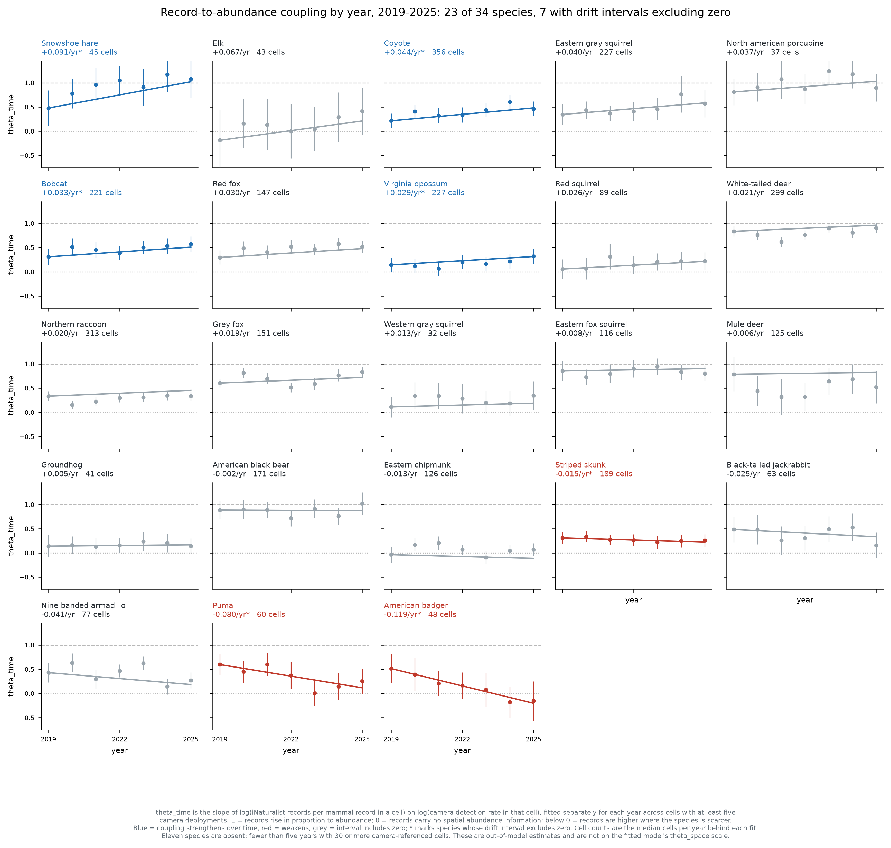

# Does the link between iNaturalist records and animal abundance hold steady over time?

## Take-home points

1. **The strength of the link between iNaturalist records and animal abundance
   is not a fixed property of a species.** Of 23 species with enough camera data
   to test, 7 show a change over 2019-2025 large enough that the estimate's
   95% interval excludes zero: 4 strengthen and 3 weaken.
2. **American badger changes most, and changes sign.** Its coupling runs from
   +0.52 in 2019 to -0.15 in 2025, a drift of -0.119 per year. A positive value
   means records are more numerous where badgers are more common; a negative one
   means they are more numerous where badgers are *scarcer*. Badger crosses from
   the first state to the second inside seven years.
3. **Coyote strengthens at +0.044 per year**, from +0.22 to +0.46, on 356 cells
   per year -- the largest sample of any species here, so this is the
   best-supported single result in the set.
4. **The fitted models assume this cannot happen.** Both parameters that link
   the two data streams are declared as single numbers in the model code, held
   fixed across all 18 years. Any real change over time has nowhere to go except
   the parameter that carries the iNaturalist-only population trend, which means
   a changing reporting relationship and a changing population are currently
   indistinguishable.
5. **The species where this matters most cannot yet be tested.** Eleven of 34
   species have too few camera-monitored cells, and they include every species
   in the steep-decline group that prompted the question -- pronghorn, rock
   squirrel, white-tailed antelope squirrel, kit fox and grey wolf.

## Background and definitions

This project estimates population trends by fitting camera-trap detections and
iNaturalist records to one shared surface. The two data streams are linked by an
equation that says how many records to expect given how many animals are
present:

    log(expected iNaturalist records) = theta0 + theta1 x log(camera-side abundance)

**theta1** is an exponent, so the clean way to read it is as a multiplier: a
place with twice the abundance of another yields `2^theta1` times the records.
At theta1 = 1 records rise in proportion to abundance. At theta1 = 0.5 a
doubling of animals produces only a 41% rise in records. At theta1 = 0 records
carry no information about abundance at all -- the expected count is the same
everywhere regardless of how many animals are there. Below 0 the relationship is
inverted: more records where the species is scarcer, which is what an observer
effect looks like when people are concentrated somewhere the animal is not.

Two names are used here to keep the two versions apart:

- **theta_space** is the version in the fitted models: one number per species,
  estimated from all years at once. It answers "across the country, do records
  track abundance?"
- **theta_time** is the same quantity estimated separately for each year. It
  answers "is that relationship the same now as it was six years ago?"

theta_space already exists for every fitted species and is reported elsewhere.
theta_time is what this report measures.

## Why the question matters

The model's trend has two parts. One is anchored to the camera data; the other
is an increment identified only by the iNaturalist records, which absorbs any
difference between what the two streams say about change over time. Because
theta_space is a single number, a species whose reporting relationship
strengthened over the record cannot express that anywhere in the model. The
extra records that strengthening produces look exactly like extra animals, and
are absorbed into the iNaturalist-only trend increment.

That is not a hypothetical concern for this fleet. Several species carry an
iNaturalist trend their camera data does not corroborate, and until theta_time
is measured there is no way to say whether those are real disagreements about
abundance or an artifact of the reporting relationship changing.

## Methods

**What is computed.** For each species and each year from 2019 to 2025:

1. Build a reference measure of how common the species is in each 50 km grid
   cell, from camera data alone: the proportion of camera deployments in that
   cell that recorded the species at least once. Only cells with at least five
   deployments are used, so the proportion is not based on one or two cameras.
   This reference is built once from all 2019-2025 deployments and held fixed
   across years, so that any change detected is a change in the record-abundance
   relationship rather than a change in the reference.
2. For the same cells, compute the iNaturalist rate in that year: the species'
   records in the cell divided by all mammal records in the same cell and year.
   Dividing by the local mammal total is the effort correction -- it accounts for
   how many people were posting observations in that place that year, which rose
   steeply over the period.
3. Regress the log of the iNaturalist rate on the log of the camera reference
   across cells, weighted by the local mammal record total so that
   well-observed cells count more. The slope of that line is theta_time for
   that species and year.
4. Fit a straight line through the seven annual estimates, weighted by their
   precision. Its slope is the drift, in units of theta per year, and it is
   reported with a 95% interval.

**What it assumes.** That the species' spatial pattern of abundance is roughly
stable over the seven years, so that a changing slope reflects changing
reporting rather than animals redistributing. For a national-scale fit where the
modelled trend is close to spatially uniform, this is reasonable; for a species
genuinely expanding into new country it would not be.

**Where it fails.** It needs enough cells with both camera coverage and
iNaturalist records in every year. Species with sparse camera data give annual
estimates too noisy to detect any drift, which is why 11 species are absent.

**What it is not.** These are estimates made outside the fitted model, using a
raw camera detection rate rather than the model's full camera submodel with its
covariates and spatial smoothing. They are therefore on a different scale from
theta_space: the pooled version of this estimator ranges 0.16 to 0.83 across
species where the fitted models give 0.42 to 0.56. **Read the slope over time,
not the level, and do not quote these as theta values.**

## Results

**Figure 1.** Each panel is one species. Points are the coupling estimated for
that year alone, with 95% intervals; the line is the fitted drift. The dashed
line at 1 marks records rising in proportion to abundance, the dotted line at 0
marks records carrying no abundance information. Blue means the coupling
strengthened over the period, red means it weakened, grey means the interval
includes zero. Panels are ordered from the strongest strengthening to the
strongest weakening. **Take-home: the relationship is stable for most species
but demonstrably moves for seven of them, in both directions.**

Seven species show drift whose interval excludes zero:

| Species | 2019 | 2025 | Drift per year | 95% interval | Cells per year |
|---|---|---|---|---|---|
| Snowshoe hare | 0.48 | 1.08 | +0.091 | +0.023 to +0.158 | 45 |
| Coyote | 0.22 | 0.46 | +0.044 | +0.002 to +0.086 | 356 |
| Bobcat | 0.31 | 0.57 | +0.033 | +0.001 to +0.066 | 221 |
| Virginia opossum | 0.14 | 0.32 | +0.029 | +0.001 to +0.056 | 227 |
| Striped skunk | 0.31 | 0.26 | -0.015 | -0.028 to -0.001 | 189 |
| Puma | 0.60 | 0.25 | -0.080 | -0.154 to -0.006 | 60 |
| American badger | 0.52 | -0.15 | -0.119 | -0.149 to -0.089 | 48 |

A drift of +0.044 per year, coyote's value, means the exponent rises by about
0.26 over the six-year span. In practical terms a cell with twice the coyote
abundance of another produced about 1.16 times the records in 2019 and about
1.38 times the records in 2025 -- the records became a meaningfully better guide
to where the animals are.

Badger is the only species to cross zero. In 2019 its records were more common
where badgers were more common; by 2025 the relationship had inverted, so its
records now point away from the animals. On its own this makes badger's
iNaturalist data unusable for locating badgers in recent years.

The sixteen species whose intervals include zero are consistent with a stable
relationship, though for the sparser ones -- porcupine at 37 cells, western gray
squirrel at 32, groundhog at 41 -- the test has little power and "no detected
drift" should not be read as "no drift".

## What to do differently

**Add a drift term to the model, rather than reporting this as a caveat.** The
minimal change is one additional parameter:

    theta1 in year t = theta1 + theta1_drift x (year - midpoint)

One number, testable against zero, and interpretable directly. Its value is that
it separates the iNaturalist-only trend increment into two parts that are
currently fused: genuine disagreement between the streams about how abundance is
changing, and change in how well records track abundance.

Estimating 18 free annual values instead is not advisable. The early years are
far too thin -- several species have only single-digit record counts before 2012
-- and the parameters would not be identified.

**Validate by simulation before fitting the fleet.** The established practice on
this project is that no estimator ships without a simulation study that
generates data from known truth and reports absolute error, interval coverage
and root-mean-square error across a grid of scenarios. The existing simulation
design cannot serve here: it holds the record-abundance relationship fixed by
construction, so it can neither recover a drift parameter nor show what ignoring
one costs. Generating data with drifting coupling is a new scenario axis.

**Test on coyote first.** It has the largest sample of any species, a clear
strengthening signal, and an iNaturalist trend its cameras contradict -- so it
is the case where the new parameter should make the most visible difference.

## Limitations

- **Eleven of 34 species could not be tested**, because fewer than five years
  had at least 30 cells carrying both camera coverage and iNaturalist records.
  The absent species include the entire group of steep western declines that
  motivated this question: pronghorn, rock squirrel, white-tailed antelope
  squirrel, kit fox and grey wolf. For those, whether the coupling is stable is
  unknown rather than confirmed.
- **The window is seven years.** The model's record runs 18 years, and the
  earlier period cannot be tested this way because camera coverage before 2019
  is too sparse to build a reference from. Drift over the full record may be
  larger or smaller than what is measured here.
- **The camera reference carries its own error**, which is not propagated into
  the annual estimates. Measurement error in the reference biases a regression
  slope toward zero, so the annual values are likely conservative and the drift
  estimates could be understated.
- **Species redistribution is not separable from reporting change.** A species
  genuinely shifting its range toward or away from camera-monitored areas would
  produce the same signature. Nothing in this analysis distinguishes the two.
- **These estimates are not on the fitted model's scale** and are not a
  substitute for fitting the drift parameter. They establish that the
  relationship moves; they do not quantify by how much within the model.

## Glossary

- **Coupling** -- the strength of the relationship between iNaturalist record
  counts and animal abundance across space, measured as theta1.
- **theta0, theta1** -- the intercept and exponent linking the two data streams.
  theta0 sets the overall level of records and is not interpreted; theta1 is the
  quantity of interest.
- **theta_space** -- theta1 as the fitted models estimate it: one value per
  species, pooled over all years.
- **theta_time** -- theta1 estimated separately within each year.
- **Drift** -- the change in theta_time per year, from a line fitted through the
  annual estimates.
- **Effort correction** -- dividing a species' records in a cell-year by all
  mammal records in that same cell-year, to account for how many observers were
  active there.
- **Cell** -- a 50 km grid square, the spatial unit of the intensity process.
